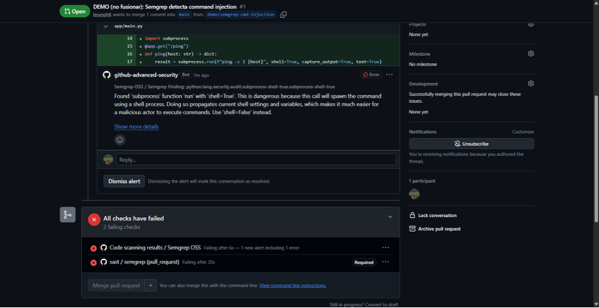
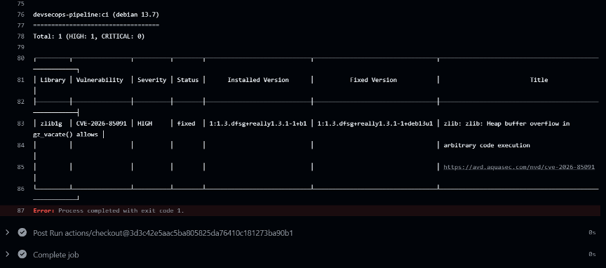
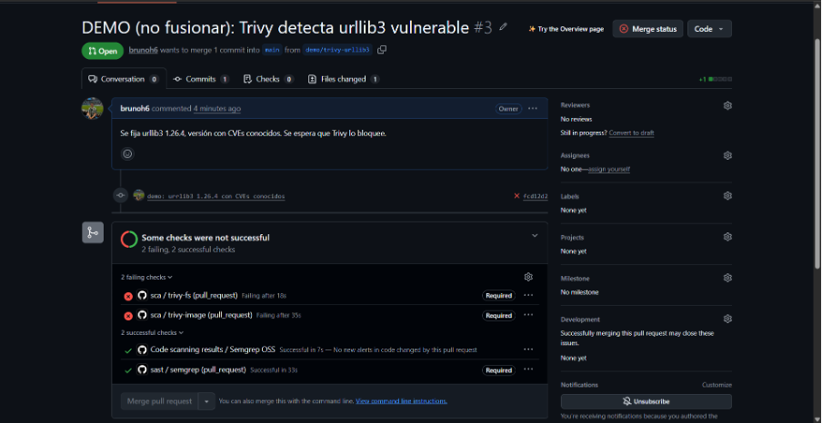
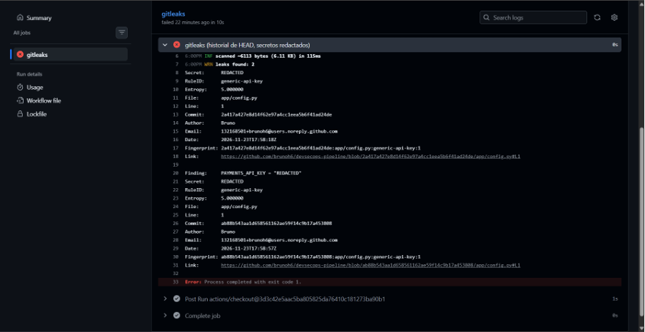
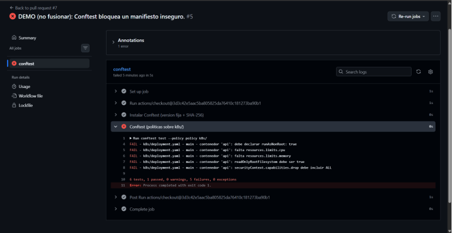

# devsecops-pipeline

[](https://github.com/brunoh6/devsecops-pipeline/actions/workflows/sast.yml)
[](https://github.com/brunoh6/devsecops-pipeline/actions/workflows/sca.yml)
[](https://github.com/brunoh6/devsecops-pipeline/actions/workflows/secrets.yml)
[](https://github.com/brunoh6/devsecops-pipeline/actions/workflows/policy.yml)

A small FastAPI service used as the target of a security pipeline in GitHub Actions.
Every pull request to `main` must pass these checks before it can be merged (enforced by a branch ruleset: PR required, checks required, no force pushes).

## What each gate catches

| Gate | Tool | Catches | Blocks the PR when |
|---|---|---|---|
| SAST | Semgrep CLI, `p/python` rules | Insecure code patterns (command injection, `shell=True`, `eval`, ...). Results are also uploaded as SARIF to code scanning. | Any finding |
| SCA | Trivy `fs` | Known CVEs in the pinned Python dependencies (`requirements.txt`) | HIGH/CRITICAL with a fix available |
| Image | Trivy `image` | CVEs in the image built in CI (Debian packages + installed libraries) and secrets left in layers | HIGH/CRITICAL with a fix available |
| Secrets | gitleaks | Credentials anywhere in the branch's git history, not only in the current files | Any finding (redacted in the logs) |
| Policy as code | Conftest + Rego v1 | Insecure Kubernetes manifests in `k8s/` | Any `deny` |

Conftest policies (`policy/deployment.rego`): `runAsNonRoot`, `allowPrivilegeEscalation: false`, `readOnlyRootFilesystem: true`, `capabilities.drop: [ALL]`, CPU and memory `limits`, and a fixed image tag (no `latest`).

## Demonstrations

Each gate has a pull request opened on purpose with a flaw and closed without merging.

### 1. Semgrep: command injection ([#1](https://github.com/brunoh6/devsecops-pipeline/pull/1))
An endpoint passing user input to `subprocess.run(..., shell=True)`. Rule `python.lang.security.audit.subprocess-shell-true`; merge blocked.



### 2. Trivy: vulnerable dependency ([#3](https://github.com/brunoh6/devsecops-pipeline/pull/3)) and a real finding ([#2](https://github.com/brunoh6/devsecops-pipeline/pull/2))
- **#3:** pinning `urllib3==1.26.4` fails both Trivy jobs with 8 HIGH CVEs (e.g. CVE-2021-33503). Semgrep stays green: each tool sees a different layer.
- **#2:** while adding the image scan, Trivy found CVE-2026-85091 (HIGH, zlib) in the official `python:3.12-slim` image: Debian had already published the fix, but the image had not been rebuilt yet. Fixed by applying Debian updates in the Dockerfile.




### 3. gitleaks: a secret "removed" in a later commit ([#5](https://github.com/brunoh6/devsecops-pipeline/pull/5))
An invented API key is committed and then replaced by `os.environ` in the next commit. The final diff looks clean, but gitleaks scans the history and finds it in both commits.
GitHub push protection works earlier (it rejects the push) but only for known provider formats; a generic key gets through, and once pushed it is exposed: the fix is rotating the credential, not deleting it.



### 4. Conftest: insecure manifest ([#7](https://github.com/brunoh6/devsecops-pipeline/pull/7))
Root allowed, writable root filesystem, no limits, and `drop: ["ALL"]` indented two spaces too little, so `capabilities` ends up empty. That last one is a mistake I really made while writing the manifest: `grep` says it is fine; the policy, which reads the parsed YAML, does not. Result: 5 failures.



## Design decisions

- **Supply chain of the pipeline itself:** actions are pinned by commit SHA, and Trivy, gitleaks and Conftest are downloaded as release binaries and verified against a hard-coded SHA-256 instead of using their actions (after the `trivy-action` tag hijack in March 2026, GHSA-69fq-xp46-6x23).
- **Least privilege:** `GITHUB_TOKEN` is read-only; only the Semgrep job gets `security-events: write`; `persist-credentials: false`.
- **Actionable gates:** Trivy blocks on HIGH/CRITICAL with a fix available; unfixed CVEs are tracked, not used to break builds.
- **Container:** numeric `USER 10001`, so `runAsNonRoot` can be verified; read-only root filesystem with an `emptyDir` for `/tmp`; `seccompProfile: RuntimeDefault`; no service account token.

## Limitations

- SCA reports the presence of a vulnerable package, not whether the code is reachable.
- Policies only evaluate what is in the file: an empty manifest passes (visible in the history of #7). Schema validation (e.g. kubeconform) would cover it.
- The image is built and scanned but not published; the manifest exists as the target of the policies, it is not deployed.
- Scanner versions and hashes are updated by hand.

## Run locally

```bash
python3 -m venv .venv && . .venv/bin/activate
pip install -r requirements.txt
uvicorn app.main:app --port 8000
```
